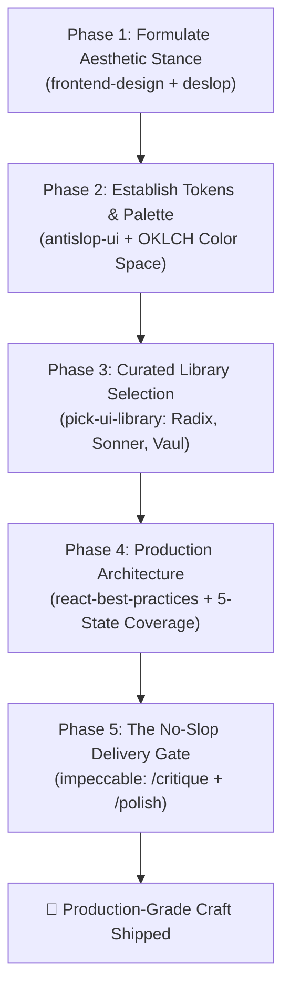

<div align="center">

# 🎨 frontend-noslop

### *The Sovereign Anti-Slop Frontend Engine for AI Coding Agents*

**Stop AI agents from generating generic, purple-gradient SaaS clones.**  
*Enforce studio-grade craft, intentional aesthetics, and production engineering across Claude Code, Cursor, Gemini CLI, Antigravity, and Codex.*

---

[](LICENSE)
[](https://skills.sh)
[](https://anthropic.com)
[](https://github.com)
[](CONTRIBUTING.md)

[**Quick Install**](#-quick-install) • [**Why This Exists**](#-the-epidemic-of-ai-slop) • [**The 8-Skill Engine**](#-the-8-skill-unified-engine) • [**The 5-Phase Pipeline**](#-the-5-phase-pipeline) • [**The Hall of Shame**](#-the-hall-of-shame-before--after)

---

</div>

<br/>

## 🌋 The Epidemic of "AI Slop" UI

Language models naturally sample the **statistical median** of open-source web code. When you ask an AI assistant to *"build a landing page"* or *"design a dashboard"*, it defaults to the same tired tropes:

* 🚫 **The Cliché Dark Gradient:** Dark slate backgrounds with blurred purple/cyan radial glow orbs.
* 🚫 **The 3-Card Grid:** An identical 3-column row of rounded cards with Lucide icons in pastel squares.
* 🚫 **Hollow AI Copy:** *"Unlock next-gen potential to seamlessly streamline your synergy."*
* 🚫 **Sparkle Buttons:** Gratuitous `✨ Magic` icons on every primary button.
* 🚫 **Fragile Code:** Root-level `"use client"`, layout jumps (CLS), and zero consideration for empty, loading, or error states.

### ⚡ The Solution: `frontend-noslop`

**`frontend-noslop`** is an uncompromising meta-orchestrator that intercepts the agent’s default generation loop and replaces it with an **enforced design-engineer workflow**. It elevates your AI from a mechanical layout generator to an award-winning design director.

---

## 🏛️ The 8-Skill Unified Engine

`frontend-noslop` does not reinvent the wheel—it fuses the **8 most battle-tested frontend & craft skills in the global AI ecosystem** into a single cohesive pipeline:

| Integrated Skill | Origin / Author | What It Brings to Your Agent |
|---|---|---|
| **`impeccable`** | Paul Bakaus (ex-Google) | The non-negotiable **Craft Floor**, plus `/critique`, `/polish`, and `/audit` commands. |
| **`frontend-design`** | Anthropic | Mandates an **intentional aesthetic stance** (e.g. Editorial Brutalism, Luxury Minimal) before any code is written. |
| **`design-taste-frontend`** | Leonxlnx | Optical balance, whitespace tension, mathematical typography scales, and visual rhythm. |
| **`frontend-design-deslop`** | Samber | Eliminates median Tailwind clichés, enforces OKLCH color palettes and semantic `DESIGN.md` tokens. |
| **`antislop-ui`** | Miqdad Badjuber | Concrete visual rules banning generic blue-purple treatments and robotic components. |
| **`no-ai-slop`** | Peter Yang | Cleanses UX copy, headlines, and microcopy of AI jargon and throat-clearing fluff. |
| **`pick-ui-library`** | Emil Kowalski | Opinionated, taste-driven library selection (Radix, Sonner, Vaul, CMDK, Motion). |
| **`react-best-practices`** | Vercel Engineering | Server Components (RSC) optimization, streaming boundaries, and zero-CLS skeleton reservation. |

---

## 🔄 The 5-Phase Pipeline

When `frontend-noslop` is active, every UI task is processed through an immutable 5-phase quality gate:



---

## ⚡ Quick Install

### 1. Universal Skills CLI (Any Agent)
The fastest way to install across 70+ agent environments (Claude Code, Cursor, Copilot, Antigravity, Codex):

```bash
npx skills add AhmadJalhoom20/frontend-noslop -g -y
```

### 2. Google Antigravity / Gemini CLI
Native installation into your global agent config:

```bash
git clone https://github.com/AhmadJalhoom20/frontend-noslop.git ~/.gemini/config/plugins/frontend-noslop
```

### 3. Claude Code Marketplace
```bash
/plugin marketplace add AhmadJalhoom20/frontend-noslop
/plugin install frontend-noslop
```

---

## 🥊 The Hall of Shame: Before & After

| The AI Default (Slop) 🤮 | The `frontend-noslop` Standard 🏆 |
|---|---|
| **Color:** `bg-gradient-to-r from-purple-500 to-indigo-600` | **Color:** Intentional OKLCH brand palette with verified WCAG 2.1 AA contrast ratios. |
| **Layout:** Centered title + 3 identical cards in a row | **Layout:** Asymmetric editorial layouts, dynamic data rows, contextual interactive previews. |
| **Typography:** Default Inter font with arbitrary `text-[15px]` | **Typography:** Curated font pairings (e.g. architectural Serif headers with Grotesque body) on a strict modular scale. |
| **Copy:** *"Empower your team with cutting-edge synergy"* | **Copy:** Crisp, punchy, human statements describing actual capabilities and real metrics. |
| **States:** Blank page while loading, abrupt content pop-in | **States:** Mathematical layout skeletons matching final dimensions (Zero Cumulative Layout Shift). |
| **Icons:** Random pastel-backed icons with sparkle badges | **Icons:** Minimalist, optically centered semantic icons (or no icons where clean typography speaks louder). |

---

## 🧰 The Curated Stack

We strictly enforce **Emil Kowalski's** curated frontend toolchain to guarantee high-craft tactile feel:

* **Primitives & A11y:** [Radix UI](https://www.radix-ui.com/) / [Base UI](https://base-ui.com/) (Headless, accessible, keyboard-first)
* **Toasts & Notifications:** [Sonner](https://sonner.emilkowal.ski/) (Physics-based responsive toast stack)
* **Mobile Drawers & Sheets:** [Vaul](https://vaul.emilkowal.ski/) (Fluid, drag-to-dismiss gesture physics)
* **Command Palette (K-Bar):** [CMDK](https://cmdk.paco.me/) (Fast, zero-dependency search)
* **Motion & Physics:** [Motion (Framer)](https://motion.dev/) (Layout animations, spring damping)
* **Virtualization:** [React Virtuoso](https://virtuoso.dev/) (Smooth infinite lists)

---

## 🚦 The Delivery Gate Checklist

Before code is marked as complete, the agent must check off every item on the **Craft Floor**:

- [x] **No Default Gradients:** All color variables derive from intentional brand tokens.
- [x] **All 5 Component States Handled:** Empty, Loading Skeleton, Populated, Error with Retry, Disabled.
- [x] **Full Keyboard Accessibility:** Every interactive element is reachable via `Tab` with visible focus rings.
- [x] **True Responsive Geometry:** Flawless visual hierarchy from 360px mobile up to ultrawide monitors.
- [x] **No AI Cliché Words:** Completely free of *"seamless"*, *"elevate"*, *"next-gen"*, and *"unlock"*.

---

## 🤝 Contributing

We welcome community audits, new anti-slop rulesets, and curated library additions!  
Feel free to open an [Issue](https://github.com/AhmadJalhoom20/frontend-noslop/issues) or submit a [Pull Request](https://github.com/AhmadJalhoom20/frontend-noslop/pulls).

---

## 📜 License

Distributed under the **MIT License**. See [`LICENSE`](LICENSE) for more information.

<br/>

<div align="center">
  <sub>Crafted with passion by <a href="https://github.com/AhmadJalhoom20">Ahmad Jalhoom</a>. Say goodbye to AI slop forever.</sub>
</div>
